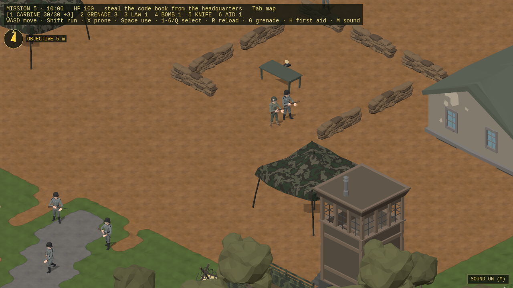
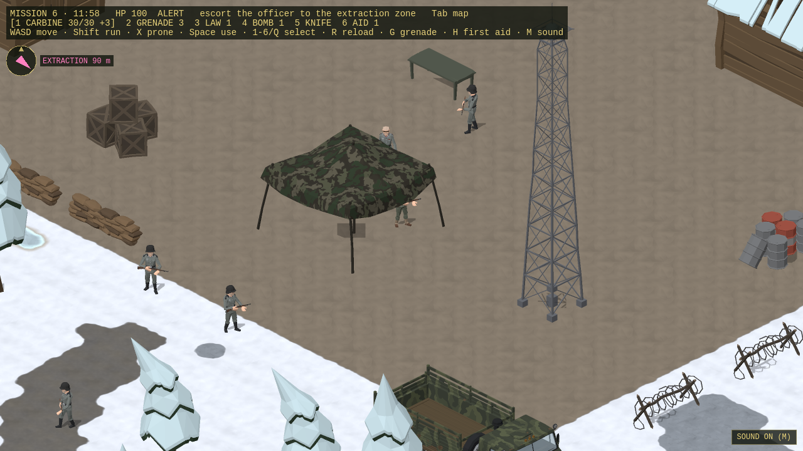
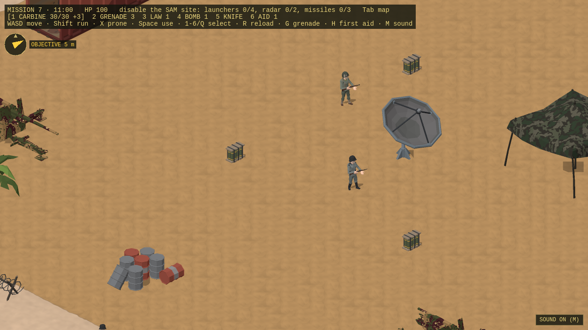
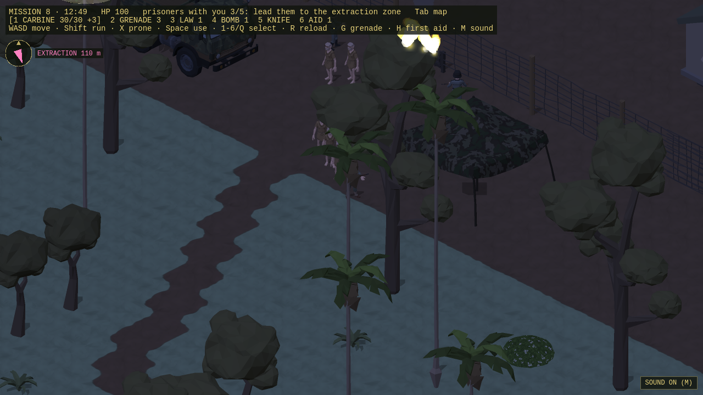
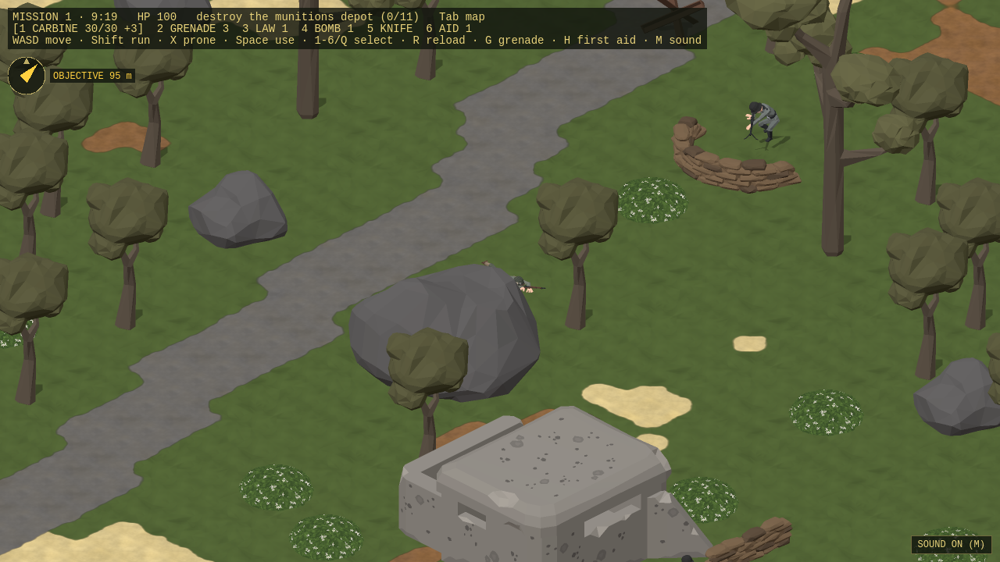
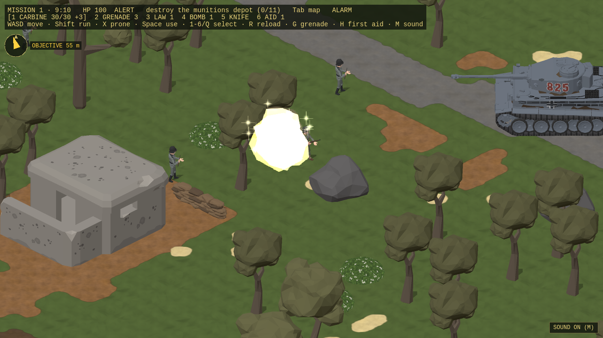
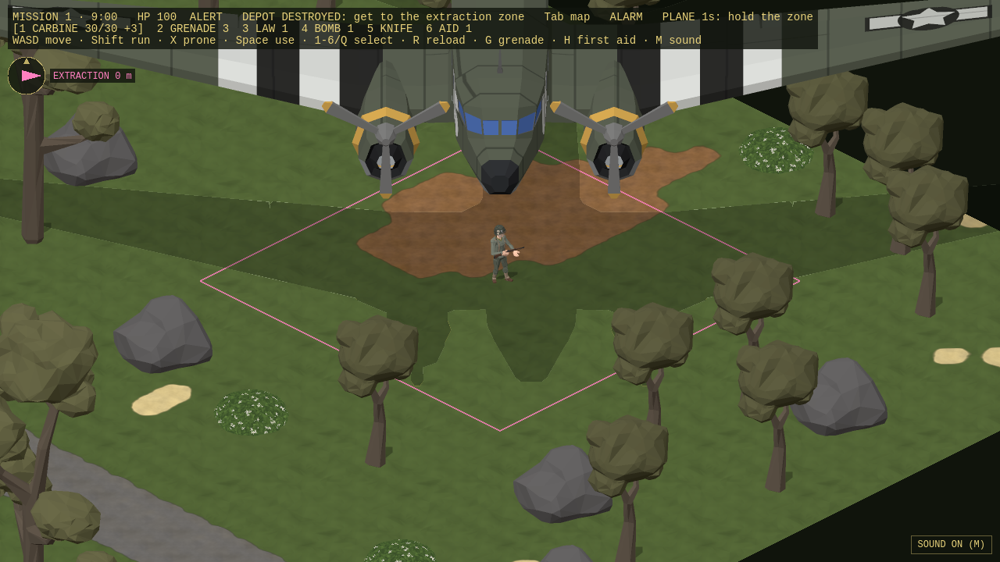
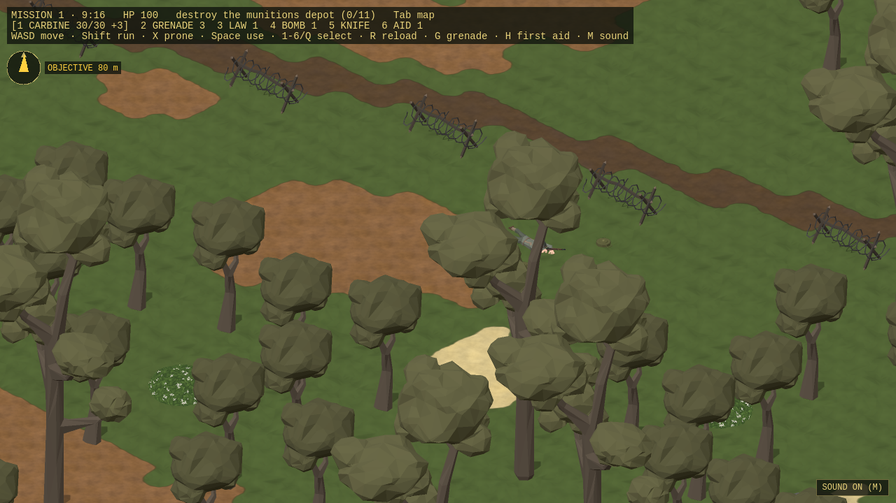
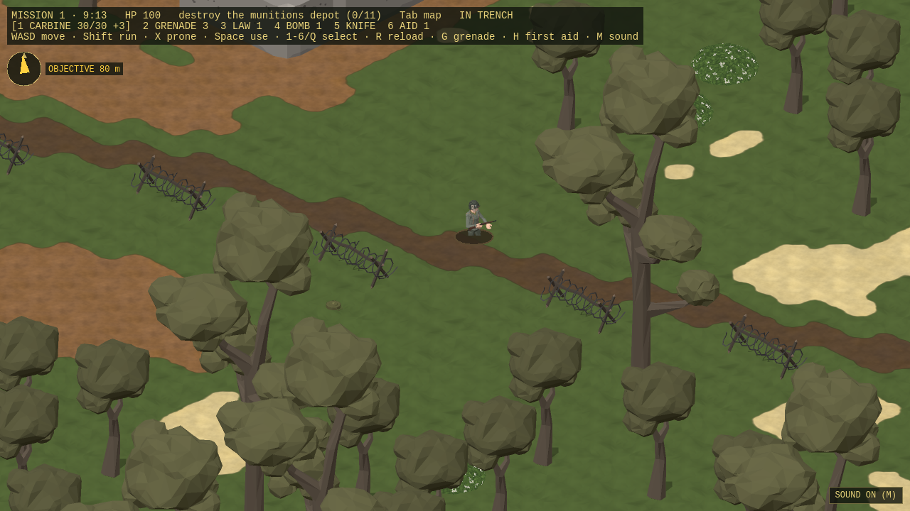
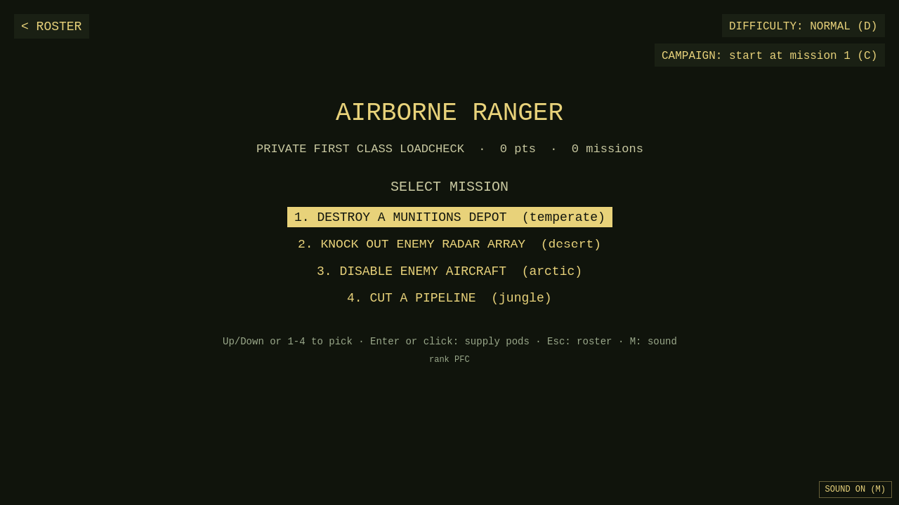

# Airborne Ranger (remake)

A remake of MicroProse's **Airborne Ranger** (1988) in Phaser 3 with an isometric view. Every sprite, tileset and map was
made with the [Synty Sprite Generator](https://github.com/ali3b/synty-sprite-generator) through its `ssg` CLI and MCP
tools, from Synty POLYGON 3D models.

**▶ [Play in your browser](https://ali3b.github.io/airborne-ranger/)** (desktop keyboard, or touch on phones and tablets) ·
**[Gallery](https://ali3b.github.io/airborne-ranger/gallery/)**: gameplay video, screenshots, map previews, every sprite animated live, tilesets.


## Controls

| | |
|---|---|
| Move | `W` `A` `S` `D` or arrow keys (8 directions) |
| Run | `Shift` |
| Prone / crawl | `X` |
| Shoot | `Space` |
| Grenade | `G` |
| Sound on/off | `M` |
| Weapons and items | `1`–`6` carbine, grenade, LAW, time bomb, knife, first aid; `Q` cycles; `R` reload; `H` first aid |
| Overview map | `Tab` or `O` |
| Call the plane (extraction zone, objective done) | `C` |
| Menus | `↑` `↓` and `Enter`; `1`–`6` picks a Ranger; on the mission select `D` difficulty, `C` campaign |

On phones and tablets (best held sideways): drag on the left half for a stick (push to the edge to run), and use the
FIRE, GRENADE and PRONE buttons on the right, with the item bar (rifle, grenade, LAW, bomb, knife, first aid) beside them, a MAP button under the compass and a CALL PLANE button under it in the extraction zone. In menus, tap a row; tap an empty slot twice to enlist, hold a row to
retire. `?touch=1` forces the touch controls on a desktop, `?touch=0` turns them off.

## The game

A plane drops one Ranger and three supply pods behind enemy lines. Complete the objective and reach the extraction zone
before the timer runs out, then call the plane and hold out until it picks you up. Machine-gun nests, hidden
minefields, trenches, tanks (only a LAW or a time bomb stops them) and alerts that spread into an alarm stand in the
way. Play Easy, Normal or Hard, single missions or the campaign (the missions in order with one Ranger). Merit earns promotions (PFC to COL) and medals for a persistent roster of six Rangers.
Each mission area is 128×256 m (drop in the south, objective in the far north), and before the drop you pack the
supply pods: magazines, grenades, first aid, LAW rockets and time bombs, up to 21 items and a weight limit.
Missions 5–8 have their own objectives: walk up to the code book to take it; get close to the enemy officer and he
surrenders and follows you (don't shoot him); blow the P.O.W. camp's gate or stand at it to cut the wire, then lead
the prisoners out (they follow you; the debriefing counts the rescued).

| Mission | Climate | |
|---|---|---|
| 1 · Destroy a Munitions Depot | temperate |  |
| 2 · Knock Out Enemy Radar Array | desert |  |
| 3 · Disable Enemy Aircraft | arctic |  |
| 4 · Cut a Pipeline | jungle, dusk |  |
| 5 · Steal a Code Book | temperate |  |
| 6 · Capture an Enemy Officer | arctic |  |
| 7 · Disable SAM Site | desert |  |
| 8 · Liberate a P.O.W. Camp | jungle, dusk |  |

| Roster | Drop | Debriefing |
|---|---|---|
|  |  |  |
| **Truck patrol** | **Truck wrecked** | **Map preview from the generator's MCP** |
|  |  |  |
| **Machine-gun nest** | **Tank firing** | **The plane at the extraction** |
|  |  |  |
| **Mines spotted (prone)** | **In a trench** | **Difficulty and campaign** |
|  |  |  |

## How it's made

The game is a test customer for the generator: it may only use it through `ssg` and the MCP tools (see `CLAUDE.md`), and
every gap it hits is logged in `FEEDBACK.md`, fixed in the generator, then re-tested here.

- **Sprites** are declared in `ssg.assets.json` and built with `ssg sprite apply`: real scale locked to the 64×32 tile
  (1 m per tile), isometric 8-direction views, collision footprints, object states (intact → destroyed) and looping props.
- **Tilesets**: declared terrains with Wang corner transitions, shores, cliffs and junction tiles, exported as Tiled `.tsj`.
- **Maps** are authored with MCP `edit_map` operations (`maps/*.ops.json`) and exported as Tiled `.tmj`.
- **Engine**: Phaser 3.80, TypeScript, Vite; procedural WebAudio sound.

## Running it locally

The generated assets (`public/assets/`) aren't committed; they're rebuilt from the declarations with the generator running.

```sh
npm install
npm run assets   # needs the Synty Sprite Generator (ssg) and its server
npm run dev      # http://localhost:5195
npm run check    # Playwright load check of every scene
node scripts/deploy-pages.mjs   # build the game + gallery and publish to GitHub Pages (gh-pages branch)
```

## Credits

Fan remake for testing the Synty Sprite Generator; not affiliated with MicroProse. 3D models © Synty Studios, rendered
into sprites. The original game's files are not included.
